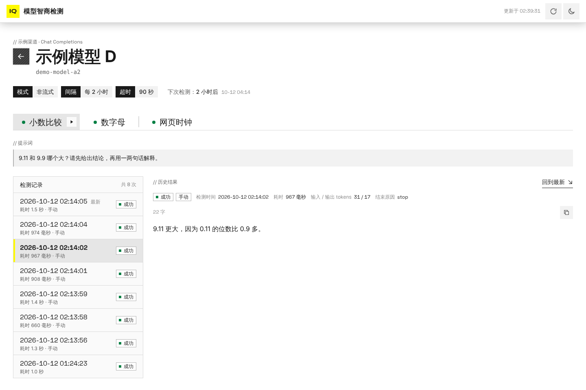

# 模型智商检测

定时向各家大模型发出同一组"智商检测题"，把它们的回答原样展示给访客。管理员在后台配置渠道、模型和题目；访客打开首页就能看到每个模型最近一次的回答——纯文本直接显示，回答里夹着的 HTML 网页放进一个小窗口里渲染出来。

界面用的是 [@endfield-ui/react](https://github.com/icaruszezen/endfield-ui)（终末地风格组件库），支持亮色 / 暗色主题和手机屏幕。


## 功能

- **渠道**：每个渠道是一个大模型 API 接入点，可选四种端点类型：OpenAI Chat Completions、OpenAI Responses、Anthropic Messages、Google Gemini。填基础地址和密钥即可，OpenAI 兼容的中转、DeepSeek、OpenRouter、vLLM 等用 Chat Completions。支持额外请求头，能一键测试连接并拉取上游的模型列表。
- **模型**：选一个渠道里的模型来检测（可以从渠道拉取的列表里挑），每个模型单独设置：
  - 流式还是非流式请求；
  - 输出超时时间（超时后保留已经收到的部分输出）；
  - 检测间隔（分钟 / 小时 / 天）；
  - 要测哪几道题、最大输出 tokens、温度。
- **提示词**：一个题库，每道题可以分配给任意多个模型。新装好时自带三道示例题。
- **调度**：内置定时器，到点自动检测；后台可以随时"立即检测"某个模型或某一道题。同时检测的模型数可以限制，同一个模型的几道题依次检测。
- **前台检测页**：列出所有启用的渠道和模型，每个模型一张卡片，宽屏一行三张（平板两张、手机一张），同一排的卡片一样高。卡片上只显示每道题最新一次的结果：提示词、检测时间、耗时、首字延迟、tokens 和模型的回答；回答较长时在卡片里滚动查看。有题目失败或超时时，卡片右上角会标出几道。检测进行中时，流式请求的输出会实时刷出来。
- **模型详情页**：点卡片上的模型名或"历史记录"进入（`/models/{id}`）。左边按时间倒序列出这道题的历次检测，点哪一次右边就显示哪一次的完整回答，网页预览的窗口也更大；记录多时可以继续加载更早的。地址里带着选中的题和那一次检测，可以直接分享。
- **HTML 网页渲染**：模型的回答里出现 ```` ```html ```` 代码块，或者文字中间直接夹着 `<!DOCTYPE html>…</html>` 的完整网页时，前台会在一个小窗口里渲染它，可以切换看源码、全屏查看。其余文字原样显示。
- **管理后台**：`/admin`，账号密码来自环境变量，未登录时后台页面和所有后台接口都不可用；前台页面上没有后台入口。

| 模型详情页 | 手机上的检测页（暗色） |
| --- | --- |
|  |  |


## 部署

### Docker（推荐）

每次推到 main，GitHub Actions 会自动构建镜像并推送到 `ghcr.io/icaruszezen/apimodelcheck`（amd64 和 arm64 都有），服务器上只要 `docker-compose.yml` 一个文件，不用下载源码：

```bash
mkdir apimodelcheck && cd apimodelcheck
curl -fsSLO https://raw.githubusercontent.com/icaruszezen/ApiModelCheck/main/docker-compose.yml
echo "ADMIN_PASSWORD=$(openssl rand -base64 18)" > .env   # 随机生成一个后台密码
cat .env                                                  # 记下这个密码
docker compose up -d
```

打开 `http://服务器地址:3000` 是前台，`http://服务器地址:3000/admin` 是后台。

更新到最新版本：

```bash
docker compose pull && docker compose up -d
```

- **数据**：SQLite 数据库和登录会话密钥存在名为 `amc-data` 的卷里，重启、`docker compose down` 再 `up`、更新镜像都不会丢；只有 `docker compose down -v` 或者 `docker volume rm` 删掉这个卷才会丢。不用 compose、直接 `docker run` 时记得加 `-v amc-data:/app/data`。
- **镜像标签**：`latest` 跟着 main 分支；推一个 `v1.2.3` 这样的标签会另外生成 `1.2.3` 和 `1.2`；每次构建还有一个 `sha-<提交号>`。想固定版本就把 `docker-compose.yml` 里的 `latest` 换掉。
- **自己构建**：把 `docker-compose.yml` 里的 `image:` 一行换成 `build: .`，在源码目录里运行 `docker compose up -d --build`。fork 之后用自己仓库构建的镜像时，把镜像名换成 `ghcr.io/你的用户名/仓库名`（全小写）。
- **镜像拉不下来**（提示 `unauthorized` 或 `denied`）：GitHub 上新建的镜像默认是私有的。到仓库主页右侧的 Packages 里打开这个镜像，在 Package settings 里把可见性改成 Public；或者在服务器上用有 `read:packages` 权限的令牌 `docker login ghcr.io`。

想用自己的密码就直接编辑 `.env`，写成 `ADMIN_PASSWORD=你的密码`；密码里有 `$` 时用单引号括起来。没有设置 `ADMIN_PASSWORD` 时 `docker compose` 会直接报错，不会用一个大家都知道的默认密码启动。compose 只从 `.env` 里取 `ADMIN_PASSWORD`；要放在反向代理后面时，取消 `docker-compose.yml` 里 `TRUST_PROXY` 那一行的注释，并把端口映射改成 `127.0.0.1:3000:3000`，让外网只能经过代理访问。

### 直接用 Node 运行

需要 Node.js 22.22 或更高版本（服务端是 TypeScript，靠 Node 自带的类型剥离直接运行，不用编译）。

```bash
npm ci
npm run build                       # 构建前端到 dist/web
ADMIN_PASSWORD=你的密码 npm start    # 默认监听 3000 端口
```

数据默认存在项目目录下的 `data/`。数据库里明文保存着上游 API 密钥，所以服务启动时会把数据目录（新建时）设为 `0700`、数据库文件设为 `0600`；已经存在的数据目录本身不会改，多用户的机器上请自己 `chmod 700 data`。

### 放在反向代理后面

生产环境建议放在 HTTPS 反向代理后面，并设置 `TRUST_PROXY=1`（前面有几层代理就写几）。这时登录限流按 `X-Forwarded-For` **最右边**的那一项（也就是你的代理追加的真实地址）识别访客，左边客户端自己填的部分不会被采信。Nginx 可以这样写：

```nginx
location / {
    proxy_pass http://127.0.0.1:3000;
    proxy_set_header Host $http_host;                             # 保留浏览器看到的主机名和端口
    proxy_set_header X-Forwarded-For $proxy_add_x_forwarded_for;
    proxy_set_header X-Forwarded-Proto $scheme;
    proxy_buffering off;
}
```

Caddy v2 的 `reverse_proxy 127.0.0.1:3000` 用默认配置就行；Apache 需要 `ProxyPreserveHost On`。只有在本服务的端口不能被外网直接访问时（比如 `HOST=127.0.0.1`，或 Docker 端口只映射到 `127.0.0.1:3000:3000`）才设置 `TRUST_PROXY`，否则别人可以绕过代理直接连上来伪造这些头。反过来，放在代理后面却不设它，所有访客会共用代理的 IP，有人连输 10 次错密码就能让管理员 15 分钟登不上。

### 环境变量

| 变量 | 默认值 | 说明 |
| --- | --- | --- |
| `PORT` | `3000` | 监听端口 |
| `HOST` | `0.0.0.0` | 监听地址 |
| `DATA_DIR` | `./data` | 数据目录：SQLite 数据库 `app.db` 和会话密钥 |
| `ADMIN_USERNAME` | `admin` | 后台用户名 |
| `ADMIN_PASSWORD` | 无 | 后台密码。**不设时每次启动生成一个临时密码打印在日志里**；少于 8 个字符，或者是 `change-me`、`password`、`123456` 这类常见密码时，启动日志里会打印警告 |
| `SESSION_SECRET` | 自动生成 | 登录会话的签名密钥；不设时生成后存在 `DATA_DIR/session-secret` |
| `TRUST_PROXY` | `0` | 信任的反向代理层数（见上一节）。`0` / 不设表示不信任任何 `X-Forwarded-*` 头；`1`（或 `true`）表示前面有一层代理；`2`…`10` 是多层，比如 CDN → Nginx → 本服务写 `2`。设为 N 时客户端 IP 取 `X-Forwarded-For` 从右往左第 N 项，同时信任 `X-Forwarded-Proto` 和 `X-Forwarded-Host`。写别的值服务会拒绝启动 |
| `SCHEDULER_TICK_SECONDS` | `15` | 调度器多少秒检查一次有没有到期的模型 |
| `NODE_USE_ENV_PROXY` + `HTTPS_PROXY` | 无 | 请求上游 API 需要走 HTTP 代理时设置，如 `NODE_USE_ENV_PROXY=1 HTTPS_PROXY=http://127.0.0.1:7890` |

改了 `ADMIN_PASSWORD` 并重启后，所有已登录的会话都会失效。会话在使用中失效时，后台会弹出一个登录窗口，打开着的编辑抽屉和没保存的内容都还在，重新登录后再点一次保存就行；因为没登录而没加载出来的页面会自己重新加载。

登录限流：同一个 IP 15 分钟内输错 10 次密码后封禁 15 分钟，同时发来的大量登录请求也最多只会比对 10 次密码。

## 使用

1. **添加渠道**（后台 → 渠道）。选端点类型，填基础地址和 API 密钥。表单下面会实时显示实际的请求地址，规则是：

   | 基础地址写成 | OpenAI Chat / Responses | Anthropic Messages | Google Gemini |
   | --- | --- | --- | --- |
   | 留空 | 官方地址 `https://api.openai.com/v1/chat/completions` | `https://api.anthropic.com/v1/messages` | `https://generativelanguage.googleapis.com/v1beta/models/{模型}:generateContent` |
   | 只写到域名：`https://api.example.com` | 补 `/v1`：`…/v1/chat/completions` | 补 `/v1`：`…/v1/messages` | 补 `/v1beta`：`…/v1beta/models/{模型}:generateContent` |
   | 最后一段是版本号：`https://openrouter.ai/api/v1` | 直接接后缀：`…/api/v1/chat/completions` | 直接接后缀：`…/v1/messages` | 直接接后缀：`…/v1/models/{模型}:generateContent` |
   | 带前缀、最后一段不是版本号：`https://api.deepseek.com/anthropic` | 直接接后缀：`…/anthropic/chat/completions` | 先补 `/v1`：`…/anthropic/v1/messages` | 先补 `/v1beta`：`…/v1beta/models/{模型}:generateContent` |
   | 完整地址：`https://x.com/v1/chat/completions` | 原样使用 | 原样使用 | 原样使用 |

   所以 Anthropic 兼容接口直接填厂商文档里的基础地址就行，比如 DeepSeek `https://api.deepseek.com/anthropic`、Kimi `https://api.moonshot.cn/anthropic`、智谱 `https://open.bigmodel.cn/api/anthropic`、OpenRouter `https://openrouter.ai/api`。Gemini 走 Cloudflare AI Gateway 时填 `https://gateway.ai.cloudflare.com/v1/{账号}/{网关}/google-ai-studio`；Vertex AI 的地址（路径里有 `/publishers/`）不补版本段。Gemini 流式请求用 `:streamGenerateContent?alt=sse`，拉取模型列表用同一个根路径加 `/models`，基础地址里的查询参数会保留。

   基础地址里不能带用户名和密码（`user:pass@host`）；中转需要 Basic 认证时，在额外请求头里加 `Authorization: Basic …`。
2. **准备提示词**（后台 → 提示词）。想让模型输出网页，就在题目里要求它写 HTML。
3. **添加模型**（后台 → 模型）。选渠道，填模型 ID（或点"从渠道获取"从列表里挑），勾选要测的题，设好请求方式、超时和检测间隔。保存后十几秒内就会进行第一次检测，之后按间隔自动检测。模型列表里点名称可以编辑，"更多"菜单里可以只检测某一道题；"检测记录"页展开一条记录，也可以"重新检测这一条"。
4. **打开首页**看结果，点模型名进入详情页翻看历史。

一些说明：

- 超时从发出请求开始计时，到模型输出结束为止。超时的检测记为"超时"，已经收到的部分输出照样保存和展示。
- 每个"模型 × 提示词"默认保留最近 20 条记录，可以在后台"设置"里改。
- Chat Completions 的"最大输出 tokens"：模型 ID 以 o 加数字（o1、o3、o4-mini…）或 gpt-5 开头（可以带 `openai/` 这类前缀），或者渠道就是 `api.openai.com` 时，以 `max_completion_tokens` 发送；其余以 `max_tokens` 发送，大多数兼容服务只认这个。Anthropic 接口必须带这个参数，留空时用 8192。
- 上游单独返回的思考过程（`reasoning_content`、Anthropic 的 thinking、Gemini 的 thought、Responses 的 reasoning summary），以及回答开头的 `<think>…</think>`（或 `<thinking>`），会放在一个默认收起的"思考过程"折叠块里。有的中转会吞掉开头的 `<think>`、只留下 `</think>`，这时 `</think>` 之前的内容也算思考过程；但如果前面已经出现过 `<think>`，或者 `</think>` 在代码块里、在一整张网页里、紧跟在反引号或引号后面，就只是在谈论这个标签，不算。
- 流式响应没有结束标记就断开时，已经收到的内容照常保存，记为成功；但如果什么都没收到，记为错误"上游的流没有返回任何内容就结束了"。中转把流式响应标成 `text/plain` 或不标类型时，也会边收边显示。
- 重定向：同一个站点内的 307 / 308（比如中转给地址补一个结尾斜杠）会用同样的方法、请求体和请求头重发，最多 3 次；其余重定向（301 / 302 / 303，或者跳到别的站点）记为错误，并提示重定向到了哪里。常见原因是把 https 地址写成了 http，或者中转换了域名。
- 服务重启或停止时正在进行的检测记为"检测中断"，这些模型会在服务重新启动后马上重测，不用等满一个检测间隔。
- 错误信息在保存前会把 API 密钥、额外请求头的值、整个基础地址，以及其中的主机名、用户名密码、查询参数和路径里不常见的段（中转路径里的账号、令牌等）换成 `***`，访客看不到渠道的地址和密钥。
- 停用模型、渠道或提示词，或者把某道题从模型上取消，前台就不再显示它，它的历史记录也不再对访客开放（记录本身仍保留在后台）。

### HTML 是怎么识别和展示的

- 识别：
  - ```` ```html ```` / `htm` / `xhtml` / `svg` 代码块；
  - 没有语言标记（或标成 `xml`、`markup`、`text`、`plaintext`）的代码块，内容是完整 HTML 文档（以 `<!DOCTYPE html` 或 `<html` 开头），或者整个就是一张 SVG；
  - 代码块以外以 `<!DOCTYPE html` 开头、到 `</html>` 结束的一段（可以出现在一行中间）；
  - 整个回答就是一段 HTML 片段：以 `<` 开头、以 `>` 结尾，并且含有 `</div>`、`</style>`、`</script>`、`</svg>`、`</table>`、`</canvas>` 等闭合标签之一。生成过程中，只有以 `<div>`、`<style>`、`<svg>`、`<canvas>`、`<table>`、`<h1>`、`<p>` 这类搭页面用的标签开头的回答才先显示成"网页生成中"，以 `<b>`、`<answer>` 这类标签开头的先按文字显示。
- 内容是完整 HTML 文档的代码块里，落在 `<script>`、`<style>`、`<textarea>`、`<pre>`、`<template>` 里面的单独一行 ```` ``` ````（比如网页脚本里的 Markdown 示例）不会提前结束代码块，代码块在 `</html>` 之后的那一行 ```` ``` ```` 处结束；不在这些元素里的照常结束（比如分几个代码块讲解一张网页）。
- 展示：每一段网页放在一个 `<iframe sandbox="allow-scripts">` 里（首页卡片里约 260px 高，模型详情页和后台检测记录里约 360px，都可以全屏查看）。没有 `allow-same-origin`，网页里的脚本运行在一个隔离的源里，碰不到本站的 Cookie、存储和接口。
- 流式输出时，网页还没写完就先显示源码，写完后自动渲染，避免每收到一段就重新加载。

## 开发

```bash
npm install
npm run dev          # 同时启动后端（3000）和 Vite 开发服务器（5173），打开 http://localhost:5173
npm test             # 单元测试与接口测试
npm run typecheck    # 前后端类型检查
```

开发时没有真实的 API 密钥，可以启动仓库自带的模拟上游：

```bash
node server/test/mock-upstream.ts --port 4010
```

然后在后台把渠道的基础地址填成 `http://127.0.0.1:4010`（四种端点类型都可以），模型名决定它的行为：`mock-html`（回答中夹一个 HTML 代码块）、`mock-rawhtml`（文字中间夹一个没有代码块的网页）、`mock-think`（带思考过程）、`mock-thinktag`（`<think>` 标签）、`mock-slow-html`（慢速流式）、`mock-error`（返回 500）、`mock-hang`（一直不返回，用来测超时）等，完整列表见 `GET http://127.0.0.1:4010/v1/models`。

### 目录

```
shared/        前后端共用：接口数据结构、端点地址规则、模型输出的解析
server/        后端：Hono 接口、SQLite、调度器、登录认证
  providers/   四种上游协议的适配（流式与非流式）
  test/        模拟上游
web/           前端：React + Vite + @endfield-ui/react
  src/pages/board/   前台检测页
  src/pages/model/   模型详情页（历史记录）
  src/pages/admin/   管理后台（单独打包，访客不会下载）
  src/components/output/   模型输出的展示：文字、代码块、HTML 沙箱预览、思考过程
.github/workflows/   自动构建并推送 Docker 镜像
```

## 许可

[MIT](LICENSE)
