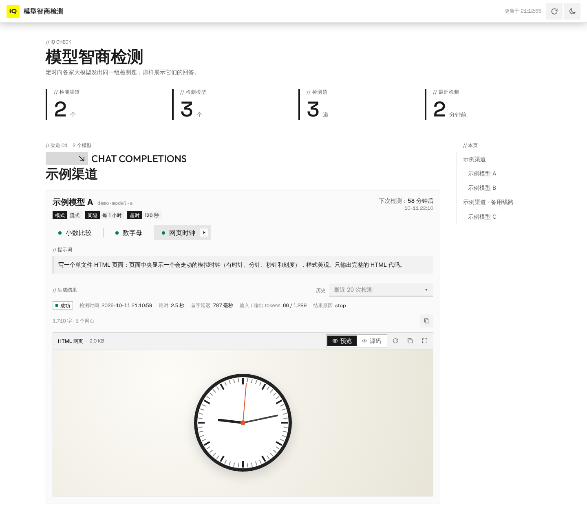
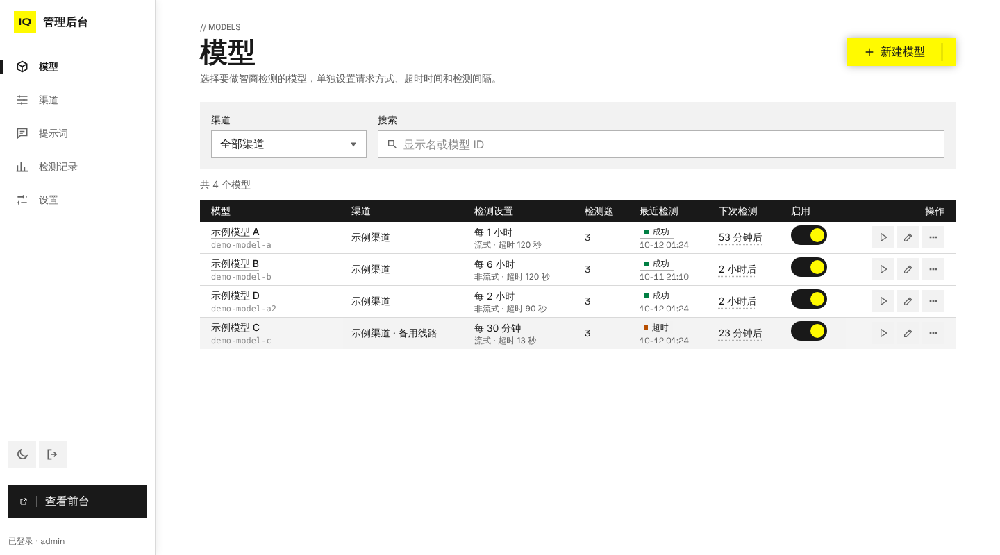
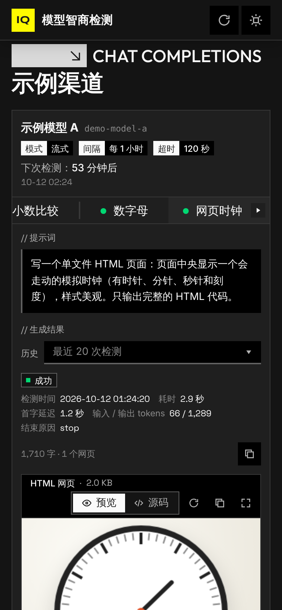

# 模型智商检测

定时向各家大模型发出同一组"智商检测题"，把它们的回答原样展示给访客。管理员在后台配置渠道、模型和题目；访客打开首页就能看到每个模型最近一次的回答——纯文本直接显示，回答里夹着的 HTML 网页放进一个小窗口里渲染出来。

界面用的是 [@endfield-ui/react](https://github.com/icaruszezen/endfield-ui)（终末地风格组件库），支持亮色 / 暗色主题和手机屏幕。



## 功能

- **渠道**：每个渠道是一个大模型 API 接入点，可选四种端点类型：OpenAI Chat Completions、OpenAI Responses、Anthropic Messages、Google Gemini。填基础地址和密钥即可，OpenAI 兼容的中转、DeepSeek、OpenRouter、vLLM 等用 Chat Completions。支持额外请求头，能一键测试连接并拉取上游的模型列表。
- **模型**：选一个渠道里的模型来检测（可以从渠道拉取的列表里挑），每个模型单独设置：
  - 流式还是非流式请求；
  - 输出超时时间（超时后保留已经收到的部分输出）；
  - 检测间隔（分钟 / 小时 / 天）；
  - 要测哪几道题、最大输出 tokens、温度。
- **提示词**：一个题库，每道题可以分配给任意多个模型。新装好时自带三道示例题。
- **调度**：内置定时器，到点自动检测；后台可以随时"立即检测"某个模型或某一道题。同时检测的模型数可以限制，同一个模型的几道题依次检测。
- **前台检测页**：列出所有启用的渠道和模型，每道题显示提示词、检测时间、耗时、首字延迟、tokens 和模型的回答，可以翻看最近 20 次的历史。检测进行中时，流式请求的输出会实时刷出来。
- **HTML 网页渲染**：模型的回答里出现 ```` ```html ```` 代码块，或者文字中间直接夹着 `<!DOCTYPE html>…</html>` 的完整网页时，前台会在一个小窗口里渲染它，可以切换看源码、全屏查看。其余文字原样显示。
- **管理后台**：`/admin`，账号密码来自环境变量，未登录时后台页面和所有后台接口都不可用；前台页面上没有后台入口。

| 管理后台 | 手机上的检测页（暗色） |
| --- | --- |
|  |  |

## 部署

### Docker（推荐）

```bash
git clone https://github.com/icaruszezen/ApiModelCheck.git
cd ApiModelCheck
# 先把 docker-compose.yml 里的 ADMIN_PASSWORD 改成你自己的密码
docker compose up -d --build
```

打开 `http://服务器地址:3000` 是前台，`http://服务器地址:3000/admin` 是后台。数据（SQLite 数据库）存在名为 `amc-data` 的卷里。

### 直接用 Node 运行

需要 Node.js 22.22 或更高版本（服务端是 TypeScript，靠 Node 自带的类型剥离直接运行，不用编译）。

```bash
npm ci
npm run build                       # 构建前端到 dist/web
ADMIN_PASSWORD=你的密码 npm start    # 默认监听 3000 端口
```

数据默认存在项目目录下的 `data/`。生产环境建议放在 HTTPS 反向代理（Nginx、Caddy）后面，并设置 `TRUST_PROXY=1`。

### 环境变量

| 变量 | 默认值 | 说明 |
| --- | --- | --- |
| `PORT` | `3000` | 监听端口 |
| `HOST` | `0.0.0.0` | 监听地址 |
| `DATA_DIR` | `./data` | 数据目录：SQLite 数据库 `app.db` 和会话密钥 |
| `ADMIN_USERNAME` | `admin` | 后台用户名 |
| `ADMIN_PASSWORD` | 无 | 后台密码。**不设时每次启动生成一个临时密码打印在日志里** |
| `SESSION_SECRET` | 自动生成 | 登录会话的签名密钥；不设时生成后存在 `DATA_DIR/session-secret` |
| `TRUST_PROXY` | 关 | 部署在反向代理后面时设为 `1`，信任 `X-Forwarded-For` / `X-Forwarded-Proto` |
| `SCHEDULER_TICK_SECONDS` | `15` | 调度器多少秒检查一次有没有到期的模型 |
| `NODE_USE_ENV_PROXY` + `HTTPS_PROXY` | 无 | 请求上游 API 需要走 HTTP 代理时设置，如 `NODE_USE_ENV_PROXY=1 HTTPS_PROXY=http://127.0.0.1:7890` |

改了 `ADMIN_PASSWORD` 并重启后，所有已登录的会话都会失效。

## 使用

1. **添加渠道**（后台 → 渠道）。选端点类型，填基础地址和 API 密钥。表单下面会实时显示实际的请求地址，规则是：

   | 基础地址写成 | 实际请求（以 Chat Completions 为例） |
   | --- | --- |
   | 留空 | 该类型的官方地址，如 `https://api.openai.com/v1/chat/completions` |
   | 只写到域名：`https://api.example.com` | 自动补版本段：`https://api.example.com/v1/chat/completions` |
   | 带路径：`https://openrouter.ai/api/v1` | 直接接后缀：`https://openrouter.ai/api/v1/chat/completions` |
   | 完整地址：`https://x.com/v1/chat/completions` | 原样使用 |

   Anthropic 补的是 `/v1/messages`，Gemini 补的是 `/v1beta/models/{模型}:generateContent`（流式为 `:streamGenerateContent?alt=sse`）。基础地址里的查询参数会保留。
2. **准备提示词**（后台 → 提示词）。想让模型输出网页，就在题目里要求它写 HTML。
3. **添加模型**（后台 → 模型）。选渠道，填模型 ID（或点"从渠道获取"从列表里挑），勾选要测的题，设好请求方式、超时和检测间隔。保存后十几秒内就会进行第一次检测，之后按间隔自动检测。
4. **打开首页**看结果。

一些说明：

- 超时从发出请求开始计时，到模型输出结束为止。超时的检测记为"超时"，已经收到的部分输出照样保存和展示。
- 每个"模型 × 提示词"默认保留最近 20 条记录，可以在后台"设置"里改。
- Chat Completions 的"最大输出 tokens"以 `max_tokens` 发送；OpenAI 的 o 系列、GPT-5 等推理模型不接受这个参数，这些模型请留空。Anthropic 接口必须带这个参数，留空时用 8192。
- 上游单独返回的思考过程（`reasoning_content`、Anthropic 的 thinking、Gemini 的 thought、Responses 的 reasoning summary），以及回答开头的 `<think>…</think>`，会放在一个默认收起的"思考过程"折叠块里。

### HTML 是怎么识别和展示的

- 识别：```` ```html ```` / `htm` / `svg` 代码块；没有语言标记但内容是完整 HTML 文档的代码块；代码块以外以 `<!DOCTYPE html` 开头、到 `</html>` 结束的一段（可以出现在一行中间）；以及整个回答就是一段 HTML 片段的情况。
- 展示：每一段网页放在一个约 360px 高的 `<iframe sandbox="allow-scripts">` 里。没有 `allow-same-origin`，网页里的脚本运行在一个隔离的源里，碰不到本站的 Cookie、存储和接口。
- 流式输出时，网页还没写完就先显示源码，写完后自动渲染，避免每收到一段就重新加载。

## 开发

```bash
npm install
npm run dev          # 同时启动后端（3000）和 Vite 开发服务器（5173），打开 http://localhost:5173
npm test             # 单元测试与接口测试
npm run typecheck    # 前后端类型检查
```

开发时没有真实的 API 密钥，可以启动仓库自带的模拟上游：

```bash
node server/test/mock-upstream.ts --port 4010
```

然后在后台把渠道的基础地址填成 `http://127.0.0.1:4010`（四种端点类型都可以），模型名决定它的行为：`mock-html`（回答中夹一个 HTML 代码块）、`mock-rawhtml`（文字中间夹一个没有代码块的网页）、`mock-think`（带思考过程）、`mock-thinktag`（`<think>` 标签）、`mock-slow-html`（慢速流式）、`mock-error`（返回 500）、`mock-hang`（一直不返回，用来测超时）等，完整列表见 `GET http://127.0.0.1:4010/v1/models`。

### 目录

```
shared/        前后端共用：接口数据结构、端点地址规则、模型输出的解析
server/        后端：Hono 接口、SQLite、调度器、登录认证
  providers/   四种上游协议的适配（流式与非流式）
  test/        模拟上游
web/           前端：React + Vite + @endfield-ui/react
  src/pages/board/   前台检测页
  src/pages/admin/   管理后台（单独打包，访客不会下载）
  src/components/output/   模型输出的展示：文字、代码块、HTML 沙箱预览、思考过程
```

## 许可

[MIT](LICENSE)
